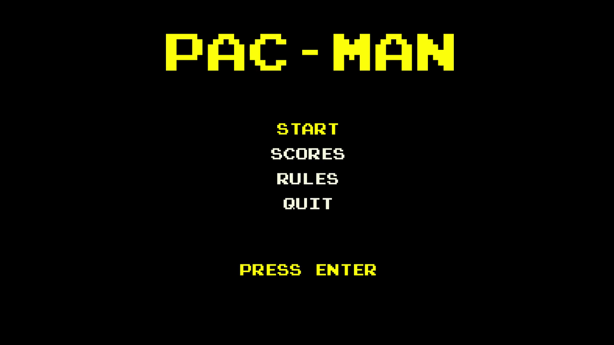
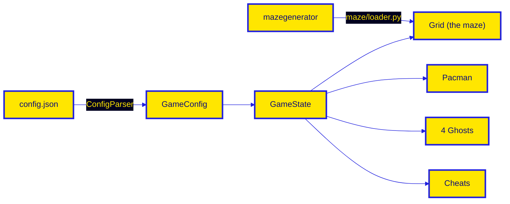
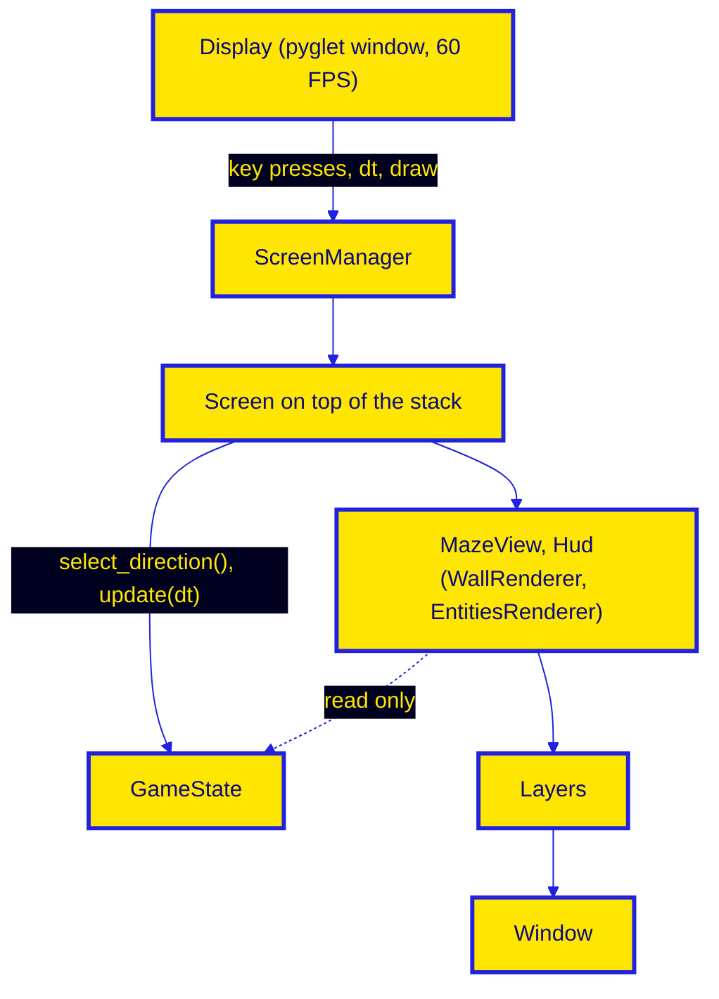

*This project has been created as part of the 42 curriculum by aslimani, tmalpert.*

# Pac-Man

## Table of contents

- [Description](#description)
- [Instructions](#instructions)
- [Configuration](#configuration)
- [Highscore](#high-score)
- [Maze Generation](#maze-generation)
- [Implementation](#implementation)
  - [Gameplay](#gameplay)
  - [Ghost AI](#ghost-ai)
  - [Cheat mode](#cheat-mode)
  - [Rendering and screens](#rendering-and-screens)
- [General Software Architecture](#general-software-architecture)
- [Project Management](#project-management)
- [Resources](#resources)

## Description

A remake of the arcade game Pac-Man in Python, made of at least 10
levels. Pac-Man eats every pacgum of a maze to finish the level, while
4 ghosts, each with its own personality, try to catch him. Eating a
super-pacgum makes the ghosts edible for a short time.

Each maze is generated by an external package (`mazegenerator`), the game is configured with a commented JSON file, and
the best scores are saved between games.

### Project Preview
<p align="center">
  
</p>

## Instructions
### Prerequisites
- Python (version pinned in `pyproject.toml`)
- [`uv`](https://docs.astral.sh/uv/) as the package manager


### Installation

```bash
git clone <repository-url>
cd Pac_man
make install
```

`uv sync` installs all dependencies declared in `pyproject.toml` / `uv.lock` into a local virtual environment.

### Make option
| Command |                  Description                      |
|---------|---------------------------------------------------|
|`run`    |Install dependencies and run src package           |
|`install`|Install dependencies                               |
|`debug`  |Launch in debug mode (PDB)                         |
|`clean`  |Remove temporary files and python artifact         |
|`lint`   |Check code quality with Flake8 and Mypy            |


## Example Usage

Install the dependencies (including the maze generator wheel in
`mazegen/`):
```sh
uv sync
```

Run the game with a default configuration file:

```sh
uv run python3 pac_man.py config.json
```
or
```sh
make run
```

## Configuration

The game is configured with a JSON file passed as the only argument.
Comments are allowed: lines starting with `#`, and `//` or `/* */`.

The file is checked by the `GameConfig` model (`src/parsing/models.py`):

- a **missing key** takes its default value, with a warning;
- an **invalid value** (wrong type or out of bounds) is replaced by its
  default value, with a warning;
- an **unknown key** is ignored.

The game never stops because of the configuration. Numbers must be real
numbers: `"3"` (a string) or `true` are refused.


|          Key          |   Type   |        Default       | Allowed  |                         Meaning                         |
|-----------------------|----------|----------------------|----------|---------------------------------------------------------|
| `high_score_filename` | text     | `"high_score.json"`  |          | File where the high scores are saved                    |
| `lives`               | integer  | `3`                  | ≥ 1      | Lives at the start of the game                          |
| `pacgum`              | integer  | `202`                | ≥ 0      | Pacgums placed in each maze, super-pacgums not included |
| `points_pacgum`       | integer  | `10`                 | ≥ 0      | Points for a pacgum                                     |
| `points_super_pacgum` | integer  | `50`                 | ≥ 0      | Points for a super-pacgum                               |
| `points_ghost`        | integer  | `200`                | ≥ 0      | Points for the first ghost eaten after a super-pacgum   |
| `seed`                | integer  | `42`                 | ≥ 0      | Seed of the first maze (`0` = random)                   |
| `level_max_time`      | integer  | `90`                 | 1 to 600 | Time limit of each level, in seconds                    |
| `width`               | integer  | `15`                 | 14 to 50 | Width of the mazes, in cells                            |
| `height`              | integer  | `15`                 | 10 to 50 | Height of the mazes, in cells                           |
| `nb_level`            | integer  | `10`                 | 10 to 99 | Levels to finish to win the game                        |
| `timer_hunt_ghosts`   | float    | `10.0`               | ≥ 1      | Seconds during which ghosts can be eaten                |
| `timer_respawn_ghost` | float    | `5.0`                | ≥ 1      | Seconds an eaten ghost waits in its corner              |

Notes:

- if `pacgum` is larger than the number of free cells, every free cell
  gets a pacgum and a warning is shown;
- the minimum size (14 × 10) comes from the maze generator: below it,
  the "42" pattern cannot be drawn.

## High Score

The best scores are kept in a JSON file, whose path is given by high_score_filename. It is managed by HighScoreManager (src/utils/high_score_manager.py).

Format. A list of at most 10 objects, from the best score to the worst:

```json
[
    { "name": "LLLL", "score": 1210 },
    { "name": "3333333333", "score": 450 }
]
```
Life of the file.

At the start of the program, the file is read once.
At the end of a game (won or lost), the player types a name of 1 to 10 characters (letters A-Z, digits and spaces). Pressing ENTER adds the score to the list and saves the file. Pressing ESC leaves without saving.
The list is sorted again and cut to 10 entries each time a score is added: a score that is too low for the top 10 is dropped. If two scores are equal, the older one stays first.

Why this way.

JSON is in the Python standard library, so there is no extra dependency, and the file stays readable (and editable) by a human.
A list of objects, rather than a name: score dictionary, because two players can have the same name, and because the order of the list is the ranking.
The file is only written when a score is added, not on every frame, so a crash in the middle of a game loses nothing that was already saved.
A problem with the file never stops the game. A missing file, an invalid JSON or a file that is not a list gives a warning and an empty list. An invalid entry (wrong type, invalid name, negative score) is ignored and the other entries are still loaded. If the file cannot be written (for example a read-only folder), a warning is shown and the game goes on. The folders of the path are created if they do not exist.

## Maze Generation

The mazes come from the `mazegenerator` package
(wheel in `mazegen/`, installed with `uv sync`). We use it as it is;
`src/maze/loader.py` adapts its output to our own `Grid`.

How it is used (`generate_maze` in `src/maze/loader.py`):

1. `MazeGenerator(size=(width, height), perfect=False, seed=seed)`
   builds the maze. `perfect=False` gives loops, needed for Pac-Man.
   Any error of the generator is caught and turned into a clear
   `GridError`.
2. The generator gives a list of rows of numbers. Each number encodes
   the walls of a cell, one bit per side: north = 1, east = 2,
   south = 4, west = 8. `convert_number_to_walls` turns it into a set of
   `Direction`.
3. Cells equal to 15 (four walls) belong to the "42" pattern: they can
   never be reached and stay empty.
4. The 4 corners get a super-pacgum. The pacgums are then placed at
   random on the free cells (not a corner, not the center, not a
   "42" cell), with `random.Random(seed)`, so the same seed always
   gives the same maze **and** the same pacgums.

Seeds: level 1 uses `seed` from the configuration, the next levels use
`0`, which means a new random maze.

Things we had to adapt to:

- the package README uses `width=` and `height=`, but the real
  parameter is `size=(width, height)`, while the maze itself is indexed
  `[y][x]`;
- the package reseeds Python's global `random` module, so our code
  always uses its own `random.Random` objects;
- Pac-Man starts in the center cell, which always falls in the empty
  column between the "4" and the "2" of the pattern (checked on every
  allowed size).

## Implementation

### Gameplay

All the rules live in `GameState` (`src/game_state/game_state.py`). The
screens only call `select_direction()` when a key is pressed and
`update(dt)` once per frame, then read the attributes to draw.

**Positions.** Positions are `(x, y)` = (column, row), in cells, as
floats. A character moves smoothly by `speed × dt` per frame, so the
game runs at the same speed whatever the frame rate.

**Movement** (`src/game_state/movement.py`). Walls can only be checked
on whole cells, so a character can only change direction when it is
exactly on a cell. It always stops on every cell it crosses: if it
would go past the next cell during a frame, it is placed exactly on
it. This way it can never go through a wall. The player can press a key
in advance: Pac-Man turns at the next opening.

**Eating.** When Pac-Man is on a cell, he eats its content
(`points_pacgum` or `points_super_pacgum`). The level is won when the
maze is empty, super-pacgums included.

**Ghosts.** A ghost has 3 states:

|  State   |                Behaviour               |           If Pac-Man touches it            |
|----------|----------------------------------------|--------------------------------------------|
| `HUNTER` | chases Pac-Man                         | Pac-Man loses a life (not when invincible) |
| `HUNTED` | runs away, half speed                  | the ghost is eaten                         |
| `EATEN`  | goes back to its corner, twice as fast | nothing                                    |

Pac-Man and a ghost touch when they are closer than 0.5 cell. After a
lost life, everybody goes back to the start.

**Super-pacgum.** Every `HUNTER` ghost becomes `HUNTED` for
`timer_hunt_ghosts` seconds and turns around. Eating ghosts with the
same super-pacgum gives `points_ghost`, then twice as much each time
(200, 400, 800, 1600 by default). An eaten ghost goes back to its
corner, waits `timer_respawn_ghost` seconds, then hunts again (even if
the other ghosts are still edible).

**Levels.** At the end of a level, a new maze is generated; score,
lives and cheats are kept. After `nb_level` levels, the game is won.

**Timers and start.** At the start of a level and after a lost life,
the ghosts and the level timer wait for the first key press. If the
level time runs out, the game is over.

**Pause.** `switch_pause()` stops everything; a finished game (won or
lost) cannot be resumed.

### Ghost AI

Ghosts follow real paths, not straight lines: a breadth-first search
(`Grid.distances_from_cell`) gives the number of steps from a target
to every cell. On each cell, a ghost takes the neighbour that is closest
to its target (`direction_toward` in `src/game_state/direction_ghost.py`),
and never turns back unless it has no other way. The map to Pac-Man is
only recomputed when he reaches a new cell.

Each ghost has its own target (`position_target`, `src/entity/ghost.py`):

|  Ghost  |  Sprite  |                                             Target                                             |
|---------|----------|------------------------------------------------------------------------------------------------|
| Shadow  | `blinky` | Pac-Man's cell: follows him closely                                                            |
| Speedy  | `pinky`  | 4 cells in front of Pac-Man: cuts him off                                                      |
| Bashful |  `inky`  | Shadow's position mirrored through the cell 2 cells in front of Pac-Man: traps him with Shadow |
|  Pokey  | `clyde`  | Pac-Man when farther than 8 cells, his own corner otherwise                                    |

If a target cannot be reached (outside the maze or in the "42"), the
ghost aims at Pac-Man instead. `HUNTED` ghosts use the same map to go
as far as possible from Pac-Man; `EATEN` ghosts use the map of their
own corner.

### Cheat mode

Cheats help testing the game. They only work once the cheat mode is
on, and stay on from one level to the next.

|          Method          |                       Effect                       | key |
|--------------------------|----------------------------------------------------|-----|
|  `switch_cheat_mode()`   | turn the cheat mode on / off                       |  c  |
|  `switch_invincible()`   | ghosts cannot kill Pac-Man (he can still eat them) |  1  |
| `switch_ghosts_frozen()` | ghosts stop moving                                 |  2  |
|      `skip_level()`      | finish the level at once (wins after the last one) |  3  |
|    `add_extra_life()`    | one more life                                      |  4  |
| `switch_speed_pacman()`  | Pac-Man twice as fast                              |  5  |
|  `switch_slow_ghosts()`  | ghosts twice as slow                               |  6  |

### Rendering and screens

**Graphics library.** The window, the keyboard and the 60 FPS clock come
from [pyglet](https://pyglet.org/). We wanted something close to the
MiniLibX: we draw the pixels ourselves into an image, and the library
only shows the finished image in the window. The pixels are handled with
NumPy, and the sprite sheets are read with Pillow.

**Sprites.** The graphics come from 3 sprite sheets in `assets/`: the
wall tiles (8 × 8 px), the entities (16 × 16 px: Pac-Man, the ghosts in
each direction, the frightened and eaten ghosts, the pacgums) and the
font (8 × 8 px). Each sheet has a JSON file that gives the tile size and
the coordinates of every named tile. It is read by the same
`ConfigParser` as the game configuration, and checked by the
`Spritesheet` model. `SpriteSheetManager` cuts the tiles, resizes them
(without smoothing, so the pixel art stays sharp), rotates them (so one
wall tile can be used in 4 directions), tints them with a color, and
keeps every result in a cache. The sizes needed by the game are prepared
once in `Assets` when the program starts, so nothing is computed while
playing.

**Window size.** The window takes 95 % of the screen. `SCALE_FACTOR`
compares it to a 4K reference, and every size (walls, entities, text) is
computed from it, so the game looks the same on every resolution. Below
854 × 480 the game stops with an error, and a warning is printed if the
screen is not 16:9.

**Layers.** A `Layer` is a pixel buffer that is shown as one image.
Separating the layers avoids redrawing what does not change:

- the **wall layer** is drawn once for each new maze;
- the **entities layer** (pacgums, super-pacgums, Pac-Man, ghosts) is
  drawn again on every frame.
**Walls.** Each cell is drawn with 3 × 3 tiles (`WallRenderer`). For
every tile, the renderer looks at the walls of the cell and of its
neighbours to choose between a line, a corner, a double line, a double
corner, and so on, and at which angle. So 7 tiles are enough to draw any
maze, and the corners are handled by one rule instead of many `if`.

**Entities.** `EntitiesRenderer` reads the positions in `GameState`
(floats, in cells) and converts them to pixels on every frame, so the
movement is smooth. The sprites change every 0.115 s (mouth of Pac-Man,
super-pacgums), which is independent of the frame rate. The sprite of a
ghost depends on its direction and its state: normal, blue (and blinking
white during the last seconds) when it can be eaten, only the eyes when
it is eaten. Pac-Man has a death animation, after a short pause.

**Text.** The text is drawn with the font sprite sheet (`draw_string`).
It supports `A`-`Z` (lower case is shown as upper case), `0`-`9`,
`+ - . : _` and the heart `❤` of the HUD.

**Screens.** `ScreenManager` keeps a stack of screens. Only the screen
at the top receives the keys, is updated and is drawn. A screen can only
ask the manager to go to another screen, to go back, to go back to the
menu or to quit (`Navigator`), so the screens do not know each other.

| Screen (`ScreenName`) | Content                                                                 |
|-----------------------|-------------------------------------------------------------------------|
| Main menu (`MAIN`)    | title and menu: Start, Scores, Rules, Quit                              |
| Game (`PLAY`)         | the maze (`MazeView`) and the HUD (`Hud`)                               |
| Pause (`PAUSE`)       | menu: Resume, Back to menu                                              |
| Rules (`INSTRUCTION`) | the rules, the controls and the cheats                                  |
| Scores (`HIGH_SCORE`) | the top 10, the first three in gold, silver and bronze                  |
| End (`ENDGAME`)       | "victory" or "game over", your score, the best score, name input        |

The screens are built from small widgets (`src/utils/widget/`): `Label`,
`Menu`, `InputField` (name input), `HighScoresLabel`, `Hud` and
`MazeView`. Each one draws itself into its own `Layer`.

**HUD.** Above the maze: the time left, the lives (hearts, then a `+`
after 3), the level, the score and the state of the cheat mode.

**Controls.**

| Where |                                           Keys                                          |
|-------|-----------------------------------------------------------------------------------------|
| Game  | `W` `A` `S` `D` or the arrows to move, `ESC` to pause                                   |
| Menus | `W` `S` or up / down to choose, `ENTER` to validate, `ESC` back                         |
| End   | letters, digits and space to type the name, `BACKSPACE`, `ENTER` to save, `ESC` to skip |
| Cheats| `C` then `1` to `6` (see [Cheat mode](#cheat-mode))                                     |


## General Software Architecture

What `GameState` is made of (built in `src/__main__.py`):



What happens on every frame:



|        Module         |                                            Content                                            |
|-----------------------|-----------------------------------------------------------------------------------------------|
| `src/entity/`         | `Direction`, `Character` (position, speed, `move`), `Pacman`, `Ghost` and its 4 kinds         |
| `src/maze/`           | `Cell` (walls, content), `Grid` (maze, `can_move`, BFS), `loader.py` (maze generator)         |
| `src/game/`           | `GameState` (rules), `movement.py`, `direction_ghost.py` (ghost AI), `collision.py`, `Cheats` |
| `src/parsing/`        | `ConfigParser` (comments, JSON) and `Spritesheet`, `Coord`, `GameConfig` in `models.py` file  |
| `src/message/`        | `Error` and its subclasses, `WarningMessage`                                                  |
| `src/utils/`          | `FileManager` and  `HighScoreManager`                                                         |
| `src/rendering/`      | `WallRenderer`, `EntitiesRenderer`, all `Widget`, and `SpriteSheetManager`                    |
| `src/screen_manager/` | `ScreenManager` as well as the implementation of all `Screen`                                 |

Relationships:

- `GameState` owns the `Grid`, Pac-Man, the 4 ghosts, the `Cheats` and
  the `GameConfig`. It is the only place that changes the score, the
  lives or the status.
- `entity/` knows nothing about the maze, and `maze/` knows nothing
  about the characters; `game_state/` connects them.
- The screens only read `GameState` (see the docstring of the class for
  the list of attributes) and call its public methods.
- Gameplay and rendering are separated: `GameState` knows nothing about
  pyglet or pixels. The renderers read the positions of `GameState` on
  every frame and do the animation themselves.
- `Display` (the pyglet window) sends the keys and the time elapsed
  since the last frame (`dt`) to the screen at the top of the stack of
  `ScreenManager`, and asks it to draw. The `Play` screen then calls
  `GameState.update(dt)` and gives the result to `MazeView` and `Hud`.
- A `Session` holds the current `GameState`, so a new game can be
  started without rebuilding the screens.

## Project Management

We worked on GitHub:
 
- the work was cut into **issues**, themselves cut into **sub-issues**,
  and followed in a GitHub **Project** board;
- each task was developed on **its own branch**, then merged back; a
  **pull request** is required to merge into `develop` and `main`;
- a **GitHub Action** (`Norm`) runs `flake8` and `mypy` on `src/`, to
  check the code before it is merged (the same checks as `make lint`).
Project management folder: `<link to the project management folder>`
 
Work split: aslimani did the gameplay (entities, maze, game rules,
ghost AI, game configuration model); tmalpert did the
graphics, the screens and the configuration parser. Each feature was
developed on its own branch and merged with a pull request.

## Resources

- [The Pac-Man Dossier](https://www.gamedeveloper.com/design/the-pac-man-dossier),
  how the original ghosts behave
- [Game Internals: Understanding Pac-Man Ghost Behavior](https://gameinternals.com/understanding-pac-man-ghost-behavior)
- [Breadth-first search (Wikipedia)](https://en.wikipedia.org/wiki/Breadth-first_search)
- [Python documentation](https://docs.python.org/3/): `enum`,
  `dataclasses`, `abc`, `collections.deque`, `random.Random`
- [Pydantic documentation](https://docs.pydantic.dev/): models and
  validators
- [pyglet documentation](https://pyglet.readthedocs.io/): window, events,
  clock, images
- [NumPy documentation](https://numpy.org/doc/): arrays, slicing, `rot90`
- [Pillow documentation](https://pillow.readthedocs.io/): reading the
  sprite sheets

### Use of AI

Rendering, screens and configuration parser: AI was used as a
mentor and a reviewer, not to build the game for us. It helped to compare
2D graphics libraries, to discuss how to split the gameplay and the
rendering, to understand profiling and caching (for the sprite sheet
manager), to set up the GitHub workflow and the `Norm` action, and to
review the code and look for bugs. The design decisions and the code were
discussed, tested and understood by us before being kept.