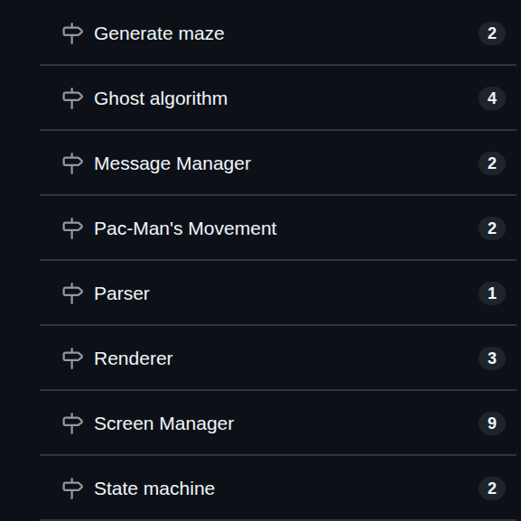
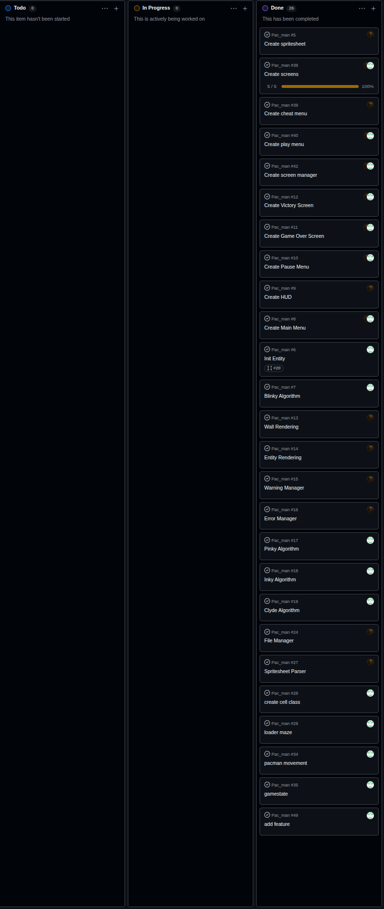
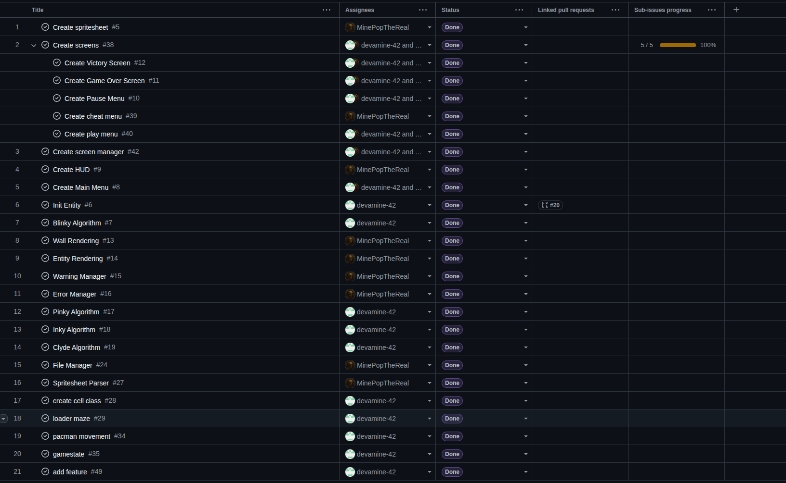
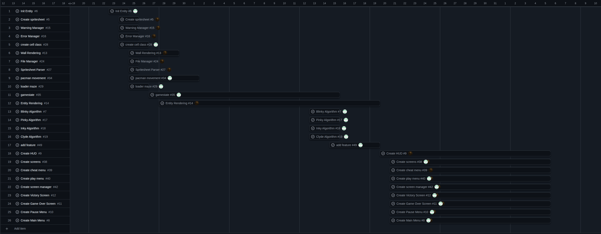

# Project Management

This document explains how our team of two organized the work on the Pac-Man project:
who worked on what, which tools and rules we used, how decisions were made, and which
difficulties we met. The screenshots mentioned below are stored in this same directory.

All screenshots were taken at the **end of the project**, so they show its final state.

---

## 1. Team and roles

We split the project along its natural boundary: **what the player sees** (rendering and
user interface) and **how the game behaves** (rules and game logic).

| Member (GitHub) |  Main area   |                     Short description                      |
|-----------------|--------------|------------------------------------------------------------|
|   `tmalpert`    | **Graphics** | Rendering, sprites, HUD, display of the screens            |
|   `aslimani`    |  **Logic**   | Game rules, entities behavior, game state, tests and debug |

"Main area" means the part each of us owns. It does not mean we never touched the other
side: we helped each other, reviewed each other's work and adjusted the split when
needed (see sections 2.3 and 7).

---

## 2. Task distribution

### 2.1 Graphics (`tmalpert`)

- Sprite sheet creation and parsing (#5, #27)
- File, warning and error managers (#24, #15, #16)
- Maze wall rendering (#13) and entity rendering for Pac-Man and ghosts (#14)
- HUD (#9)
- Display of all the screens: main menu, play menu, pause menu, game over, victory,
  cheat menu (#38 and its sub-issues)
- Performance optimizations and code cleanup (see 2.3)

### 2.2 Logic (`aslimani`)

- Entity initialization (#6) and cell class (#28)
- Maze loading (#29)
- Pac-Man movement (#34)
- Ghost algorithms: Blinky, Pinky, Inky, Clyde (#7, #17, #18, #19)
- Game state (#35) and additional features (#49)
- Logic part of the screens (see 2.3)
- A large testing and debugging phase at the end of the project

### 2.3 How the distribution evolved: the screens

The screens were originally planned to be done entirely by the graphics side. However,
the graphics work took longer than expected, so `aslimani` started the **logic part**
of the screens. Once the rest of the rendering was finished, `tmalpert` did all
the **display logic** of the screens.

At the end of the project, `tmalpert` also:

- made several optimizations on the screens, and a few on the logic side;
- cleaned up and made the code more readable in some places.

In parallel, `aslimani` carried out a large phase of testing and debugging.

This is why the screens issues are assigned to both of us on the project board.

### 2.4 Interface between graphics and logic

Both parts communicate through a small, explicit contract, so each of us can work
independently:

- The logic side manages the **frames** (the timing of the game) by itself.
- It provides the **intermediate coordinates** of Pac-Man and the ghosts as floats.
- The graphics side only converts these coordinates into **pixels** and draws the sprite
  at the right position. It does not have to compute where a sprite should precisely be
  at a given moment.

This keeps the rendering independent from the game rules: the renderer draws what it is
given, and the logic can change without breaking the display.

---

## 3. Project tracking tools

We used a **GitHub Project**, with three different views of the same data, and GitHub
**milestones** to group the issues by feature.

**GitHub Project link:** `https://github.com/users/tmalpert/projects/2

### 3.1 Milestones

Each milestone corresponds to a major feature of the game:

- Generate maze
- Ghost algorithm
- Message Manager
- Pac-Man's Movement
- Parser
- Renderer
- Screen Manager
- State machine

### 3.2 Kanban board

The board has three columns: **Todo**, **In Progress** and **Done**. Each card is an issue.
At the end of the project, all 26 items are in the *Done* column.

### 3.3 Table view

The table lists every issue with its assignee, its status, its linked pull requests and
the progress of its sub-issues. It shows who was assigned to what.

### 3.4 Roadmap (timeline)

The roadmap shows the issues on a calendar. It gives an overview of the order of the
work: foundations first (sprite sheet, managers, cell class, parsers, maze loading), then
game state and entity rendering, then the ghost algorithms, and finally the HUD and the
screens.

---

## 4. Git workflow

We used the following branch structure:

- `main`: stable version of the project.
- `develop`: integration branch.
- **One branch per milestone**, created from `develop`.
- **One branch per issue or sub-issue**, merged into the branch of its milestone.

When a milestone was finished, we opened a **pull request** to merge its branch into
`develop`. Pull requests were mandatory only for `develop` and `main`, so merging into
a milestone branch did not require one.

### Code quality

- A GitHub Action named **Norm** runs `flake8` and `mypy` on the `src/` directory. It
  runs on pushes and pull requests to `main` and `develop`.
- The same checks can be run locally with **pre-commit** hooks before pushing.
- Dependencies are managed with `uv`, with Python 3.13.

---

## 5. Decision making

- **Decisions with little impact** were taken individually by the person concerned.
- **Decisions about the structure of the project** (for example, how to design the
  screen management) were discussed together, until we found the best direction.

These decisions were taken **orally**, so there is no written trace of them.

---

## 6. Communication

We communicated regularly about what was done, what was in progress and what blocked us.
This avoided a lot of lost time, and helped us prevent Git conflicts as well as
personal conflicts.

---

## 7. Blocking points and how we solved them

- **Unbalanced task distribution.** At some point, the graphics side had too many tasks.
  We readjusted the distribution: `aslimani` started the logic part of the screens
  (see 2.3).
- **Waiting for pull request validation.** Sometimes `tmalpert` had to wait for
  the other member to validate a pull request before continuing. Since pull requests were
  only opened at the end of each milestone, this could temporarily slow down the work.
- **Different visions on some implementations.** Because of some limitations in the
  subject, we sometimes had very different ideas on how to implement a feature. After
  discussing it, we always found a good compromise.

Overall, everything went well, mostly thanks to the communication between us.